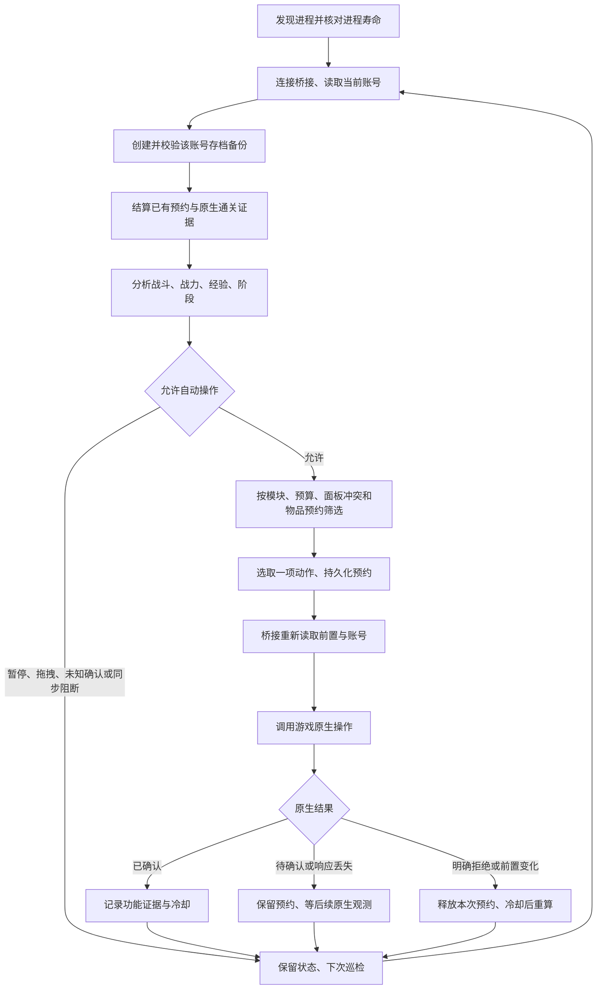

# 自动化全流程与长期养成

适用版本：2.2.12。每个账号独立记录阶段、资源、战斗证据与预约；普通进程及沙盒采用相同流程。

## 主循环

同一账号只有一个提交实例；同一实例一次提交一项动作。切场待确认时阻止新的切场、战场恢复与改编队；不冲突的成长继续。每次执行都重新读取原生状态，不复用巡检时已经过期的材料或预算。

## 从开局到后期

| 阶段 | 进入条件 | 持续行为 | 离开条件 |
| --- | --- | --- | --- |
| 连接与准备 | 进程、Steam、桥接或存档尚未就绪 | 自动重连、核对账号、校验备份 | 原生初始化完成且备份成功 |
| 主线推进 `push` | 尚未达到原生主线总关数 | 前往最高已通关后的下一关；同步装备与技能成长 | 原生前沿失败达到阈值且观察时长已到，或缺少安全入场物品 |
| 当前章节练级 `farm` | 前沿暂时受阻 | 只比较本章免费、已通关、可重复地图；实测收益、合成、回收、换装与成长 | 最短练级时间已到，且战力变化或主线重试周期到期 |
| 后期养成 `endgame` | 原生最高已通关达到主线总关数 | 持续本章免费练级和所有启用的成长模块，不再尝试超出上限的关卡 | 原生主线扩展或记录改变后重新规划 |
| 无限塔（默认关闭） | 用户开启模块，已完整通关主线，当前主线战斗结束，塔层未通关且满足原生入口 | 单次挑战，关闭继承的主线重复标记；失败按塔自己的战力与间隔限制重试 | 原生塔战结束后返回主线；完成一场主线战斗后才允许下一塔 |
| 长期维护 | 等级、关卡等里程碑逐步完成 | 保留后期循环，处理邮件、装备、资源和仍可执行的成长 | 不因计数达标自动停机或宣称全部毕业 |

主线未通关前不安排新的塔挑战。升级、换装或符文变化会使旧经验速率失效，但保留地图轮测顺序。暂停、离线、切场、手动窗口和观测中断不计作有效经验采样。

## 装备评分波动与往返

换装仍使用原生整套评分，并遵守当前最低收益、槽位保持和淘汰回切参数。在阵容、等级、技能、在线刻印、永久宠物与最高进度不变期间，记录原生确认的全队装备组合；不再回到已穿过的同一组合。组合包括角色、槽位、UID、配置ID及完整镶嵌字段，跨多个槽位和角色的往返同样受限；不同组合仍可评估协同收益。

真实成长变化或当前实际装备与记录不符（手动换装、镶嵌改变）时重新评估。纯离线刻印、战斗波次、临时评分、货币和跟随外观不重置记录。记录随账号调度保存，重启保持；每个成长条件最多512个组合，到上限等待成长，不淘汰早期组合以免重新循环。

执行前保存换装上下文；桥接重扫时验证全队装备及候选完整镶嵌修订，变化则拒绝本次提交、下轮重算。原生待确认或响应丢失期间不再提交其他换装，其他模块继续；至少等待30秒或当前动作重试间隔后仍未确认，释放旧预约并按最新原生装备重新规划，不重放旧上下文。只有立即或后续原生UID确认才记组合。旧动作无完整修订时只用原有保持与回切时间，不猜测历史组合。控制台显示“评分反复变化，等待成长后复核”。

## 16 个模块如何协调

| 模块 | 前置与主要动作 | 冲突与顺序 |
| --- | --- | --- |
| 宝箱 | 原生可开箱、背包容量可用 | 背包满时等待扩容、合成、存仓或回收；同级优先落实已证明的换装 |
| 换装 | 仅为当前上阵三人按整套原生评分联合分配背包与仓库装备 | 同一 UID 只分给一个角色；槽位保持和禁止回切；英雄与物品面板按冲突等待 |
| 主动技能 | 按职业、等级、技能槽和点数规划学习／装备／退款 | 先腾出可回收旧槽再退款与学习；保留目标技能和用户保留点数 |
| 被动技能 | 原生等级与前置链满足 | 为关键前置分配权重，与主动模块共享角色点数、逐次重扫 |
| 符文 | 原生资格和灵魂／水晶预算满足，在线收益优先，Offline 收益最低优先级兜底 | 不越过保留预算或永久符文消费开关；优先扩容、编队等成长条件 |
| 角色解锁与编队 | 原生解锁资格、已有所有权及空编队槽 | 不购买未拥有 DLC；切场待确认时不改编队 |
| 宠物 | 原生解锁资格与当前推进／练级用途 | 根据偏好选择经验、收益或战斗宠物；保留当前宠物选项生效 |
| 主线与练级 | 使用当前账号记录、章节和原生入场规则 | 收费 Boss 仅用于前沿推进；练级不消耗入场券，不跨回旧章节 |
| 合成 | 原生完整配方、方块等级、精确材料数 | 制作之后、分解之前；合成和取料先于分解；不占用打造、镶嵌、换装已保留的材料数量 |
| 淘汰装备回收 | 无角色换装价值，且未被完整配方预约 | 排除交易、锁定和未确认物品；镶嵌回收遵守用户开关，压力回收遵守品质上限 |
| 仓库 | 全部已解锁页参与原生槽位和接收规则 | 满背包可临时存仓，双满时尝试安全原生交换；没有安全方案则等待 |
| 锻造 | 上阵英雄有需求，原生配方、档位和材料完整 | 七部位自定义优先级；制作 → 合成 → 分解，缺料和冷却不阻塞后续 |
| 镶嵌 | 装备允许、原生镶嵌槽与材料类型匹配 | 同一材料只分给一个角色，不同时进入合成 |
| 邮件与离线收益 | 原生面板、附件资格和背包空间 | 邮件收取待原生结算；离线展示完成才继续加载 |
| 无限塔 | 用户开启模块、主线已通关、主线战斗结束、原生下一未通层可进入 | 不打断战斗；返回后至少一场主线；关闭模块不阻断已结束塔战返回 |
| 无人值守接续 | 已知面板关闭规则或已确认的免费战场恢复 | 全局暂停仍有效；默认收起已知普通窗口，可手动选择保留；拖拽与未知确认阻止提交；排序在物品工作完成后执行 |

所有权未知的 DLC 保持未知状态。模块关闭会停止相应新工作；已结束塔战返回和继承重复标记纠正属于收尾动作。全局暂停和单实例暂停始终优先。

## 失败、重试和重启

- 连接或桥接初始化失败：按现有退避重连；只读巡检允许重试，已发送消费不直接重发。
- 明确的原生拒绝、等待、前置变化：释放本次切场记录，按动作或模块冷却后重新规划。
- 免费切场响应丢失：持久化待确认记录阻止重叠切场；后续到达观测确认成功。超过切场确认时限后释放串行锁，冷却后允许重试。
- 收费切场结果未知：同时保留目标预约，按类别、关卡和难度阻止换 UID 再入场。只有原生到达或新的原生通关证据能够解除；超时或重启本身不证明失败。
- 快速战斗在两次巡检之间结束：保留提交前最高通关基线，新的原生通关记录仍能结算，不要求恰好看到目标关卡战斗中。
- 从旧版升级：只按动作键保存的切场预约会恢复为可观测记录；免费旧预约可按超时与冷却接续，收费未知预约继续保护。

## 验收与回滚

可复现检查：`python -X utf8 -m unittest discover -s tests -p "test_*.py"`、`node --test tests/*.test.cjs`，以及在 `web` 中执行 `npm run build`。

新增测试使用真实调度器串联前沿 Boss 通关、后期练级、重复设置、塔挑战、塔返回与下一塔，并覆盖响应丢失、应用重启、旧预约迁移和模块关闭。当前双实例可以实测连接、读取与成长；主线 160 关、角色 101 级及完整毕业仍需长期游戏证据，模拟覆盖不计作实机通关。

本次修改原文件备份位于 `output/backups/2026-11-13-full-flow/`；该目录保留同名相对路径。退出新版助手后可启动原本的 2.1.2 包恢复旧程序；源码回滚按备份清单恢复对应文件，将本次新增的 `tests/test_full_flow.py` 移出测试目录后重新构建前端。账号配置、存档与本机备份不在源码回滚范围内。

## 2.1.6 原生回收容量

规划从原生方块读取实际容量，单批单位数不超过“参数上限、原生容量、可安全回收数量”三者的最小值。堆叠里的每件都占一个预留单位；容量缺失或无效时不提交分解。每批完成后重新扫描与重新规划，继续处理余量。执行端仍要求预留 UID 与各 UID 数量完全符合本批，部分接受、超额填入、配方变化或保护变化都会拒绝消费并清理预留。

本机两个方块只读观测均为 9 格；旧版默认批量 12 件会在精确校验处等待。2.1.6 保留校验，修正规划批量。原始观测保留在私有验证目录。源码回滚备份为 `output/backups/2026-11-13-recycling-capacity/`，程序可退出新版后启动原 2.1.5；配置和存档不随源码回滚。

## 2.1.7 服务器维护与登录恢复

维护检查先于账号、存档与成长扫描，使用原生 `MaintenanceHandler.IsActive`，不按弹窗文字猜测。维护期间不采样成长，不提交物品、技能或切场，不创建未加载账号的备份。存档尚未加载作为正常连接阶段显示。

只有维护标记有效、原生确认框可交互，且确认与取消回调都精确指向静态 `AppQuitHandler.Exit`、没有多播回调时，才允许调用该框原生确认完成退出。未知确认框继续阻止提交。全局、单实例暂停及无人值守接续开关约束自动退出；关闭自动启动时不自动重开游戏。

每个普通／沙盒环境分别持久保存维护等待、进程会话、退出预约和启动预约。维护重试默认依次为 5、10、20、30 分钟，之后保持 30 分钟，并尊重更长的用户启动间隔。退出、启动均先落盘再提交；响应丢失不重放退出，重启助手不会清空退避时间。只有原生维护标记解除、在线且登录成功、存档与主表就绪才能解除维护等待；时间到达仅允许再次启动检查，不视为服务器恢复。等待期间界面显示原因和重试倒计时，进程退出后等待条目仍可见。

新增回归覆盖登录前维护、退出回执丢失、暂停、重启、分环境退避、未知回调拒绝、在线登录恢复及诊断脱敏。维护期间不能验证经验增长与毕业进度。回滚源码备份为 `output/backups/2026-11-13-maintenance-recovery/`，原 2.1.6 包保留；不要覆盖正在使用的存档与调度预约。

## 2.1.8 上阵装备与工坊顺序

当前上阵三人先比较原生整套评分并保留有效升级候选。按制作 → 合成 → 分解安排消费与取料；冷却和缺料不会阻断下一阶段。七个部位的打造优先级均默认同级，用户分别设 1～7，数字越小越优先。后备英雄不自动换装、制作或镶嵌。

锁定装备可无损存取，禁止消费和替换身上锁定装备。旧装备仍先排除升级和完整配方用途，普通品质按落后档位、压力回收上限判断；高品质 5 及以上不自动分解。开启带镶嵌回收后，合格旧装备与镶嵌一并消耗，按原生回执回收灵魂。合成允许装备／饰品在原生配方闭区间内混合档位。

离线类刻印不再自动投资；已有等级不重置。无限塔新装默认关闭，旧配置升级关闭一次，之后用户可以自行开启。全部长期毕业条件仍需后续观察，短时实机不等同毕业验收。

## 2.1.9 邮件异步结算

领取前将本批邮件 ID、观察器基线与时间持久保存。执行端重新扫描完整未读列表、加载与领取状态、原生资格；列表改变则不提交。原生 `MailPopup.ApplyClaimResults` 只读观察器在方法返回后记录逐封服务端结果，动态元数据定位，不写入游戏字段或修改返回值。

仅目标邮件的 `CLAIMED` 或 `ALREADY_CLAIMED` 回执可解除预约；前者计入实际领取证据，全部已领取仅解除等待，不新增领取成功计数。部分结果跨巡检及助手重启保留。其他账号、旧序号、无关 ID 不用于结算；同一观察器用递增序号隔离旧回执，重连则核对回执时间。

领取中、面板关闭、未读数减少、邮件消失及超时都不是成功或失败证据。有未决领取时不提交任何新批次领取，其他可执行成长继续。观察器不可用不提交领取；结果未知且回执已丢失时保留等待，不凭时间重放。界面显示未决数量，分享诊断排除邮件 ID、账号和原始回执。

回滚时认证退出 2.1.9 后启动保留的 2.1.8 包；源码备份为 `output/backups/2026-11-13-mail-settlement/`，新增 `dps_assistant/mail.py` 与两个邮件测试文件需对应移出。不要恢复旧调度文件覆盖最新预约或存档。有未决邮件时先关闭邮件模块再回滚，旧版本不能识别新的邮件防重领预约。

## 2.1.10 刻印真实升级确认

每次完整机会扫描新建一个 RuneSaveStateProvider，以原生记录重建等级缓存；执行前也重扫，使用同次提供器重核等级、满级、CanLearn 和费用。旧原生句柄及时释放，单桥接最多持有一个刻印提供器句柄。Learn 后用独立新提供器读取保存等级，仅接受返回 true 且增加恰好一级才确认，同时记录货币前后余额。既有界面仅在使用 SaveStateProvider 时通过原生 SetStateProvider 切换并刷新，预览不替换。已有离线刻印保留，所有 Offline 节点继续禁投。

回滚先认证退出 2.1.10，再启动独立保留的 2.1.9；旧版仍有此缓存缺陷，回滚时应关闭刻印模块。源码备份见 output/backups/2026-11-13-rune-investment/。不要恢复旧账号存档或调度文件覆盖最新成长和消费预约。

## 2.1.11 长期调度轮换

资格、暂停、模块开关、预算、手动冲突、原生同步和未决消费先筛选；然后遵守制作及取料 → 合成及取料 → 分解的硬顺序。普通动作在原优先级上按模块上次执行以来每 15 秒增加 1 分，不再封顶；没有执行记录时使用调度开始时间。执行后仍按既有流程保存模块时间，动作键变化及助手重启不清零等待。优先级 110 及以上的紧急恢复／塔返回等动作处于独立排序等级，普通等待再久也不能越过。

轮换只决定已允许动作的先后，不使缺料、预算不足、原生拒绝或结果未知的动作变成可执行。同一模块所有候选获得相同等待分，原有刻印偏好、装备收益和三英雄轮换继续生效。持续紧急状态、资格消失和工坊上游一直可执行时，下游工作按原规则等待；不宣称每个模块有固定墙钟执行期限。

源码备份 output/backups/2026-11-13-scheduling-fairness/。回滚先认证退出 2.1.11，再启动独立保留的 2.1.10；不要用旧调度或存档覆盖最新成长与消费预约。

## 2.1.12：单次开箱与窗口保护

原生路径为 DropManager.TryOpen → TryOpenOne → PlayerSaveData.TryPeekBox；检查 DataManager 与 ItemManager 存在、配置／掉落包与背包空位，消费箱队列后记录并创建战利品。两处泛型资格检查已通过运行时 MethodInfo 解析为 Singleton<DataManager>.get_HasInstance 和 Singleton<ItemManager>.get_HasInstance。Count 尾调用同一 PlayerSaveData 的 CountBoxes；单开不依赖 OpenAll 的解锁条件，本路径没有遍历锁定装备的门槛。

助手保留仓库／合成窗口或方块材料时，不再把单次开箱加入冲突清单；只追加新战利品，工坊、换装、转仓和切场仍等待。拖拽、交易、未知／确认弹窗、用户选择查看时全部暂停、离线、奖励同步阻断与满包继续阻止提交。任何锁定物品都不因此授权合成、分解、镶嵌或替换。

自动收起已知普通背包／成长窗口默认开启。配置内部仍使用 preserve_open_panels，以相反显示开关保持旧字段兼容；首次升级关闭旧保留默认一次，schema=1 后沿用用户设置。方块非空和拖拽时不生成收起动作。

快照保留各级宝箱数量，即使满包或面板阻止提交也能显示；Python 调度解释模块、面板、同步、未决和重试等待。原生 TryOpen 返回 false 明确标为 native_box_rejected；接受但记录未增长则 pending，维持原预约，绝不靠超时重放未知结果。

回滚先认证退出新助手，再启动独立保留的 2.1.11；保留当前调度与存档，旧版开箱的窗口冲突问题会重新出现。源码原件保存在 output/backups/2026-11-13-box-opening/。

## 2.1.13：练级结算与重试时机

1. 成长或定时条件达到且入场条件可用时，保存主线重试请求；免费练级战斗中途继续积累经验，不立即切图。
2. 原生当前关卡与难度匹配，且结果为 Cleared／Failed，或新一轮 InProgress 已进行不超过 10 秒时，允许推进。提交延迟后再次核对同一条件。
3. 等待时间达到可配置上限时接续重试；统计缺失或战斗停滞也有出口。预算、未决入场预约、面板与原生条件仍先于提交。
4. 有待重试请求时不再选择另一练级地图；前沿推进、回到练级或入场条件再次受阻时清理旧请求。
5. 试打访问标记包含收益缓存的战力身份及创建时间。新战力或缓存重建同时清零试打计时，既有探索覆盖保留，旧收益率不复用。

## 2.1.14：区分战斗条件与队伍成长

- 经验与效率观察使用上阵角色的规范排列签名，包含当前装备宠物。不同收益宠物之间切换后重新采样；后备角色和无意义的集合顺序变化不重置样本或练级路由。
- 主线与塔重试使用上阵角色、永久刻印和已解锁宠物数量的成长签名，忽略仅改变当前装备宠物的上下文切换。阵容或永久成长变化达到最短练级时间后安排重试；无变化时按原有定时间隔重试。
- 新版首次读取旧成长记录时重建基线，原练级开始时间保留。已进入推进阶段的旧重试请求保留结算等待，入场／收费预约继续由原逻辑结算。
- 老塔尝试缺少新基线时，以已确认装备、刻印、技能、宠物解锁或编队操作为兼容成长证据；宠物装备切换本身不算。
- 诊断仅导出成长阶段、时间和 party_growth／retry_interval 原因，不导出成长签名、账号或物品标识。

## 2.1.15：独立快速开箱

1. 完成原生登录、账号匹配、存档备份和唯一控制实例确认后，约每秒轻量读取三种箱数、背包容量、窗口、拖拽、网络及同步条件，不枚举角色、配方或刻印。
2. 持久化唯一批次预约后，主线程连续调用原生 TryOpen。每箱均需 accepted 与原生开箱记录增长，才计入实际箱数；不同品质轮换。最多 8 箱或约 25 毫秒后让出，原生单次调用本身无法中断。
3. 背包满、同步阻塞、交易、拖拽、未知窗口、离线或原生拒绝立即停止；初始空位同时作为批内保守上限。锁定物品不作为材料，也不会阻止新增战利品。
4. 部分成功后末箱未决时，只记确认前缀。后续只读回执观察末箱，不重新调用；完整回执丢失可向同一桥接查询，桥接重启且回执遗失时保留预约，超时和已确认前缀的记录增长均不能证明未知末箱结果。
5. 全量成长扫描仍自适应节流，但开箱不占其轮次。快速通道不改写完整快照采样时间，避免把局部数据当作新的战斗经验观测。旧单箱未决预约仅由原生记录增长解除。
6. 确认操作次数按批次统计；实际箱数独立累计于本版逐箱确认数量。原生拒绝短暂退避 5 秒，其他成长继续。全局／实例暂停、模块开关和默认关闭背包规则保持。

## 2.1.17：无损操作与实例暂停

1. 无损存取和穿戴资格独立于消费材料资格：交易标记未知、确认标记变化不单独阻止原生槽位交换。占用与登记仍避免并发冲突，锁定装备可无损存取但不消费，身上锁定不替换。
2. 普通保护指纹差异仅作诊断；按可交易配置及镶嵌分组核对数量，允许堆叠合并，发现原 UID 的可交易标记明确变 false 或可交易数量实际减少才输出 tradeChanged。此结果仅写入 warning 日志，不关闭受影响实例。连接、容量、缺料和正常物品变化也不改实例开关。
3. 运行日志保留可交易异常警告，警告不修改配置、不形成暂停门槛。手动暂停与旧版遗留暂停原因分别显示，显式恢复清除旧原因；已启用实例不受遗留保护原因影响。
4. 进程存在检查只需进程名与沙盒归属，不依赖可读取的执行路径及原生元数据。独立存在检查和启动前复核均确认不存在才启动；权限或沙盒查询未知只等待复查。启动预约与维护退避继续持久保存，真正退出后可接续。

## 2.1.18：开箱回执持久恢复

桥接在 openboxes/boxscan 原生调用返回后、HTTP 回复前，对回执执行账号和格式检查并原子保存。存储按当前进程 PID 与创建时间隔离；桥接重新接入同一游戏进程时恢复缓存，账号匹配的原生已完成批次可供 Python 结算，已保存的未决批次仍只读观察原生记录。重复请求只返回原回执，不再消费。

保存最近 32 条回执，未决项不因容量回收。相同内容不重复写盘；失败保留旧文件并由后续原生结果重试，运行日志仅警告。旧账号 pending 不阻塞新账号，但新账号不能读取旧账号的回执。游戏新寿命不能继承旧寿命证据；消费发生后、原生回执尚未回到桥接的崩溃间隙仍为未知，不用超时自动解锁。备份 output/backups/2026-11-13-durable-box-receipts。

## 2.1.19：完整目标与自动化范围

1. 原生主线、塔、全部已拥有角色、刻印、宠物、角色解锁和上阵装备槽等目标保持独立核对；不因模块关闭或 Offline 禁投变成达标。
2. 对原生目标补充 automation_items：上阵前三人的等级与在线刻印范围来自完整原生快照，关闭模块显示关闭。后备未满级只展示，不自动轮换阵容。
3. 在线统计保持原生 CanLearn 前置和预算检查；不因面板范围改变学习行为，不自动点 Offline 祖先。缺失范围、重复/缺失阵容或非法等级不报达标。
4. 原生 all_milestones_met 与逐功能实际确认不合并，不把范围完成或填满装备槽当作后期毕业。

## 2.1.20：技能树窗口接续

技能树 SkillTreePopup 属于原生普通成长窗口，加入与英雄/仓库相同的明确收起列表。默认自动关闭时，先验证对象仍可见，调用继承的 OnClickClose，再读 activeInHierarchy；只有确实隐藏才确认，仍可见则等待下次重试，对象已消失或已隐藏按过期处理。

启用保留窗口时不自动关闭技能树，仅等待会改动其内容的主动、被动、学习/退款/装配及角色解锁；开箱、独立刻印、宠物、装备与无损存取继续按各自原生条件执行。切场与共享工坊继续等待窗口关闭。确认、加载及未知弹窗不加入普通收起列表。无需变更玩家设置、阵容、离线刻印策略或游戏进程。

## 2.1.21：成长期间仍能完成练级比较

单战力有效试打时钟与收益缓存继续同生共灭，真实成长后重新采样，不复用旧战力经验率。新增同一次地图访问的有效时钟，以游戏寿命、阵容、目的图与访问开始时间为界；配置保存/助手重连不凭空增加时间，切换目的图、阵容或游戏寿命重新计时。

同战力没有可靠样本时，在 max(farm_probe_seconds, farm_sample_seconds) 后轮换；成长反复刷新窗口时，本次访问累计上限为上述值的两倍。只有观察到原生就绪、在线、免费重复战斗且未被窗口/切场阻塞的连续扫描间隔才计入；间断、离线、暂停、无候选/塔场景等不计入。已有当前战力可比较样本不因累计时长被排除，主线重试预约仍优先于练级换图。

轮换仅表示本次未拿到可比较样本，不宣称该图永久不可通关，也不虚构收益。战力变化或原有有效期规则仍可释放候选；没有其他高级免费图时保留当前场景，不回旧章节、不动入场券、不改玩家阵容或开关。

## 2.1.22：游戏重新启动后的开箱接续

每个新开箱批次在持久预约中记录其原生进程 PID、创建时间及普通/沙盒环境。同一游戏内的助手或桥接重连仍查询原批次回执；超时、箱数增加、记录增长不单独解除未知结果。

同账号新游戏原生就绪后，仅当批次身份完整、环境相同、当前进程寿命不同，且进程查询明确证明旧寿命已不存在时，将旧预约保留到本地未决历史，再处理新游戏当前队列。PID 被复用但创建时间不同也能识别；权限不足按未知处理。历史缺少身份不猜测迁移。

归档不代表旧消费成功或失败；已确认箱数保持，未知末箱不补计，旧请求 ID 永不重发。先保存归档后创建新的批次预约；保存失败恢复原预约。最近32条明细和累计未决数保存在本地，运行日志保留警告，实例开关不改变。全局、实例和模块手动关闭仍先于核对与提交。本分支不修改游戏队列、存档或奖励。

首次新批次预约提交到磁盘之前，尚未调用原生开箱。若该写盘失败，仅移除这项明确未发送的内存预约，后续巡检自动重试；已经进入原生调用后的未知结果仍按回执与进程寿命处理，不能套用这条释放规则。

## 2.1.23：所有普通动作的提交边界

普通调度动作先构造请求，再一次性写入未知结果预约及其所需观察记录。付费入场预约、切场观察、Boss票据基线、邮件观察序号、战斗恢复尝试计数、塔轮次与塔挑战记录随同一份scheduler.json原子提交，成功后才调用原生。不再先保存半份预约、再分次保存辅助记录。

若提交前准备或写盘失败，恢复本动作所涉及的七类原状态，撤回确定尚未调用原生的预约，保留此前其他未知结果和历史。后续正常巡检自动重试；不修改玩家全局/实例/模块开关，不计成功，不计作原生恢复尝试。已返回原生结果后的保存与HTTP失败属于可能已执行的分支，继续原有回执/独立观察规则，不能按未发送回滚。历史没有证据证明未发送的旧预约不凭超时清除。

## 2.1.24：打造缺料时的精确材料保留

所选打造配方尚不齐全时，按配方实际需要的数量保留已有材料，合成只使用明确多余的数量。比如需A1个、B1个，B缺货而A有10个，保留A1个，其余9个可按原生配方合成；数量不足一批时继续等待，不占用保留量。背包与可访问仓库共同分配，优先保留背包材料，合成取仓后重新规划，不改写原始库存快照。

打造材料齐全时，整个已选材料堆仍优先用于制作或取料，不同时安排其合成。锁定、可交易、已登记和未确认材料的消费保护保持；关闭仓库模块不取仓。每次消费前重扫，若材料补齐或状态变化，则旧合成计划失效。保留量也继续排除分解和普通存仓，避免跨工序重复消费。无新增配置。

## Wiki技能与刻印加点

2.2.0：技能先补当前核心主动，再从职业被动的精确前置路线与主动升级中选择下一点；不同时给所有分支加权。刻印前置只需一级，按最低开路成本／当前收益选择，独立核对灵魂和灵魂石保留量，Offline禁投。预算阻塞明确展示，其他可执行模块继续。

## 2.2.1：零预算保留与离线软回避（覆盖旧版禁投说明）

灵魂、灵魂石和技能点默认保留 0，本机按用户指示同步设为 0；显式设置仍可自行调整。在线刻印路线优先，离线收益节点在所有其他可执行成长之后兜底。等待加权不会把纯离线收益抬到在线成长之前；普通动作冷却、缺预算或不可执行时，离线候选仍可以执行，不再由规划、调度或桥接硬禁用。

在线目标必须经过离线节点时，只为未学前置投资原生最低 1 级，按在线路线排序；已经学过的离线前置不再为了开路追加等级。每次仍重扫等级、费用、CanLearn、预算并核对保存结果。在线范围已满不算全部刻印完成，自动化目标恢复为包含离线的原生全量。

未知消费回执、暂停与连接等待仍按原有协议核对；错误只日志报告，不自动关闭开关。源文件回滚备份 output/backups/2026-11-13-soft-runes；回滚程序可退出新版后启动独立 2.2.0 包。不要恢复旧存档、旧余额或覆盖新的消费回执。

## 2.2.3：天赋分支纠错与精确镶嵌许可

被动纠错在被动模块和独立退款授权均开启时生效。以允许回收的被动投入、所选核心主动超过1级的授权投入，加未用点并扣除明确保留量形成最多100点的池；未授权主动投入与核心技能的1级作为固定底座，模拟后续主动与被动候选。模拟从原生目录的解锁、上限和每一条前置计算可学状态，不依赖零点数时为false的CanLearn。

每轮只选择一个多投节点；它必须在原生CanRefund允许且撤一点后所有已学习子节点仍满足前置。先排空多投部分，再补目标缺口。共享祖先保留最高需求；断链、循环或无效目录不自动退款。角色升级、主动成长和阵容改变才使规划输入变化；逐点返还／投入使点池守恒，桥接重启可从现状重建。不是全树重置，也不变更阵容。模块关闭、手动暂停继续生效；拒绝或未知回执只等待重扫和日志，其他模块继续。

退款成功只认原生等级恰好减1且技能点恰好加1；学习成功只认等级加1且点数减1。两者执行前均从新扫描拿到当前计划，退款再检查CanRefund。不会把布尔返回或超时单独当作成功。

镶嵌前即纳入目标指纹，成功回执限定新增插槽必须对应批准材料的ID与数量、索引唯一且原插槽完整。保护检查只接受该目标的精确回执，其他字段和其他物品不豁免；异常及待确认不产生许可。

在线等待摘要始终读取全部刻印，目标筛选只影响范围。对未学习的离线前置，摘要列出路径中当前可学节点的费用；在线完成和全刻印完成分别标记。

纠错与推图协调：上阵角色仍有多投待退款或有点待回填时，不把中间战力变化触发为Boss成长重试，也不提交新主线／塔挑战。当前战斗、免费练级、回主线恢复以及其他成长照常；重配对齐后恢复挑战判断。关闭被动模块或纠错授权后不保留该等待。可执行技能投资优先于整理排序，退款和回填处于相同优先级，避免回收后长时间不投入。

## 2.2.6：离线收益与在线成长判断

离线刻印继续最低优先级投资，也可作为在线路线的必要前置；已确认的离线收益等级变化不计作在线战力变化。经验采样、主线成长重试和无限塔成长门槛使用已验证的在线刻印等级，仍计入在线经验／收益与战斗刻印。原生总目标继续包含离线节点，三个预算保留量默认均为0。

旧调度的总刻印基线在首次取得完整在线／离线计数时只迁移一次，保留练级开始时间、重试请求及等待边界，不把计数口径切换算作成长。新塔提交保存相同口径；旧塔尝试只重建成长基线，不重置挑战时间或清除消费预约。旧快照缺少可靠分项时继续使用旧总数比较，不能根据缺失字段猜测离线升级。

## 2.2.7：按射程判定前排加点

职业天赋的前排上下文使用本次原生角色目录的 BaseStat.Range，选取上阵队伍中唯一最短射程者，不把编队列表第一位、后备英雄或当前存活者当作前排。只调整职业分配上下文，不改玩家编队、主动组合模板或原生加点资格。

任一上阵射程缺失、无效、重复角色或最短射程并列时，前排判定为未知；仅暂缓依赖前排的守护职业被动退款和学习，核心主动及其他职业、战斗、装备与成长继续。数据完整后自动恢复原有有限点数重配；被动模块和退款开关继续生效。

原生表只读取基础射程，不使用临时战斗状态改变天赋目标。该规则与已缓存 Wiki 一致，离线排列验证不代表实机换队、最优 DPS 或通过第40关。

## 2.2.8：前沿已入场时的练级切换

入口门槛可能在上一关结束前暂时使调度转入练级，而原生自动推进随后已经进入下一前沿。若当前关尚未通关、原生战斗记录匹配且仍 InProgress，返回练级先等待本场结算，避免主动中断已入场 Boss。继承的重复开关可关闭，不重新入场；装备、刻印、技能和其他成长继续。

沿用主线与练级切换的结算等待参数，默认180秒。等待按游戏会话、关卡、难度、原生战斗序号保存，助手重启保持，同一场超时后允许返回；新一场或游戏会话改变重新计时。完成或离开当前前沿时清理等待。未通关前沿的新开场同样保护，不能用普通练级的10秒开场窗口中断。

执行前的原生重扫再次验证；调度后才自动推进到前沿时，没有该场超时许可就等待。许可须匹配关卡／难度／战斗序号，原生时长不得倒退，且等待达到当前参数；旧许可不适用于下一场。玩家暂停和模块开关继续有效，未知结果预约仍按原逻辑结算。

## 2.2.9：天赋纠错受阻时继续自动化

有可执行退款或等待回填时，仍优先完成上阵天赋重配，再安排新主线或无限塔挑战。若规划明确为原生不允许退款且无退款动作，则仅跳过本次纠错，按原有成长／时间条件继续练级、主线重试和其他模块；不会把未纠正的天赋标记为完成，也不强行调用原生退款。

每次原生扫描重新判断退款资格。执行挑战前再次重扫，若退款资格已恢复且存在纠错动作，仍先接续重配。技能目录无效也只跳过相关纠错。每名角色在同一受阻状态期间仅写一次警告，去重状态随调度保存，助手重启保留；资格恢复、关闭相关开关或角色移除后清理，之后重新受阻可再次报告。警告包含于本机事件与脱敏诊断，不增加原生成长成功计数。玩家暂停、模块开关、门票、预算和未知结果预约仍生效。

## 2.2.11：核心主动与被动共享有限纠错预算

允许主动退款且主动模块开启时，把所选主动超过1级的投入纳入同一有限点池；所选技能保留1级，未选技能继续走原有卸下／回收流程。被动是否可退独立遵守被动开关。按相同职业策略从固定底座重建目标，先逐点撤销偏离目标的投入，再回填。每次退款前重新扫描、对齐目标及当前等级，调用原生CanRefund与Refund，核验精确等级-1／点数+1。原生拒绝时记录去重警告并继续其他自动化。当前战斗不中止，仅在可执行纠错／回填期间等待新挑战；暂停与模块设置仍生效。此规划不声称最优DPS或实机毕业。

## 2.2.12：满级队员与经验选图

经验效率按原生目录的 characterMax 排除已满级上阵队员，只取其余队员中最低的连续收益。全队仍参与战斗、阵容完整性和就绪检查；等级上限缺失或无效时保守保留全部队员。等级、采样范围、原生上限变化或旧缓存迁移会清除旧速率，不混算。全队确认满级后清理经验采样时钟，不再因零经验轮图或标记采样超时；装备、刻印、当前场景与主线重试按各自规则继续，模块和手动暂停不变。满级分支为离线回归覆盖，不代表实机101级或毕业。
