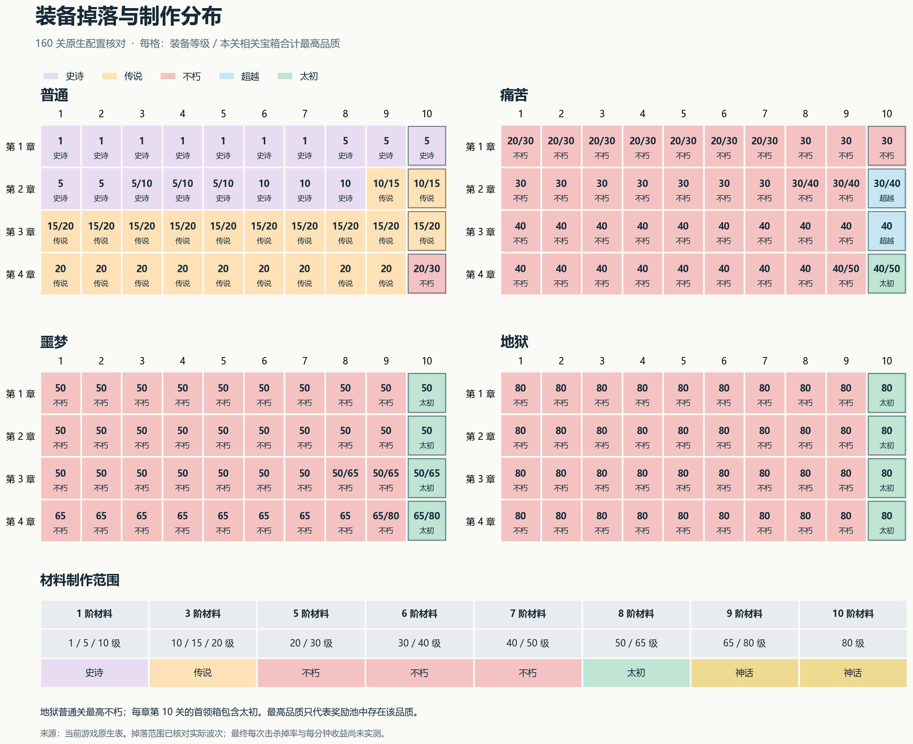
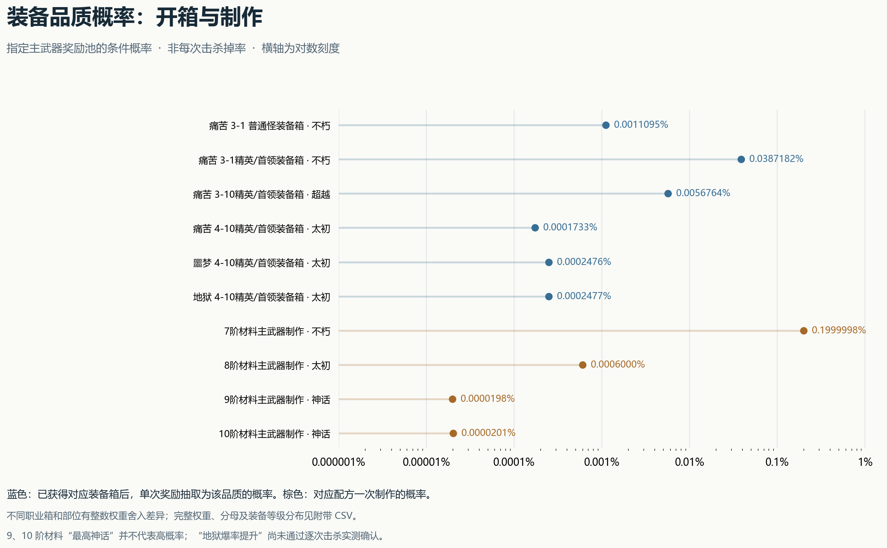

# 装备箱分布、品质权重与制作范围

已将玩家图片与当前游戏原生配置交叉核对，图中的等级范围和品质上限一致。图片本身没有概率；以下概率来自随机奖励表的整数权重归一化。

## 关卡装备分布

这是关卡关联装备箱的可能产出范围；普通怪箱、精英箱及章节首领箱的品质池不同。区间内出现高品质上限，不代表普通怪箱也能开出该品质。

| 关卡 | 装备等级 | 本关装备箱合计最高品质 |
| --- | --- | --- |
| 普通 1-1 ～ 普通 1-7 | 1 | 史诗 |
| 普通 1-8 ～ 普通 2-2 | 5 | 史诗 |
| 普通 2-3 ～ 普通 2-5 | 5 / 10 | 史诗 |
| 普通 2-6 ～ 普通 2-8 | 10 | 史诗 |
| 普通 2-9 ～ 普通 2-10 | 10 / 15 | 传说 |
| 普通 3-1 ～ 普通 3-10 | 15 / 20 | 传说 |
| 普通 4-1 ～ 普通 4-9 | 20 | 传说 |
| 普通 4-10 | 20 / 30 | 不朽 |
| 痛苦 1-1 ～ 痛苦 1-7 | 20 / 30 | 不朽 |
| 痛苦 1-8 ～ 痛苦 2-7 | 30 | 不朽 |
| 痛苦 2-8 ～ 痛苦 2-9 | 30 / 40 | 不朽 |
| 痛苦 2-10 | 30 / 40 | 超越 |
| 痛苦 3-1 ～ 痛苦 3-9 | 40 | 不朽 |
| 痛苦 3-10 | 40 | 超越 |
| 痛苦 4-1 ～ 痛苦 4-8 | 40 | 不朽 |
| 痛苦 4-9 | 40 / 50 | 不朽 |
| 痛苦 4-10 | 40 / 50 | 太初 |
| 噩梦 1-1 ～ 噩梦 1-9 | 50 | 不朽 |
| 噩梦 1-10 | 50 | 太初 |
| 噩梦 2-1 ～ 噩梦 2-9 | 50 | 不朽 |
| 噩梦 2-10 | 50 | 太初 |
| 噩梦 3-1 ～ 噩梦 3-7 | 50 | 不朽 |
| 噩梦 3-8 ～ 噩梦 3-9 | 50 / 65 | 不朽 |
| 噩梦 3-10 | 50 / 65 | 太初 |
| 噩梦 4-1 ～ 噩梦 4-8 | 65 | 不朽 |
| 噩梦 4-9 | 65 / 80 | 不朽 |
| 噩梦 4-10 | 65 / 80 | 太初 |
| 地狱 1-1 ～ 地狱 1-9 | 80 | 不朽 |
| 地狱 1-10 | 80 | 太初 |
| 地狱 2-1 ～ 地狱 2-9 | 80 | 不朽 |
| 地狱 2-10 | 80 | 太初 |
| 地狱 3-1 ～ 地狱 3-9 | 80 | 不朽 |
| 地狱 3-10 | 80 | 太初 |
| 地狱 4-1 ～ 地狱 4-9 | 80 | 不朽 |
| 地狱 4-10 | 80 | 太初 |

地狱各普通关仍以不朽为上限；1-10、2-10、3-10、4-10的章节首领装备箱才扩展到太初。“地狱最高80太初”是整个难度的上限，不能套在每一种箱子上。

## 制作范围

| 材料阶级 | 可能装备等级 | 最高品质 |
| --- | --- | --- |
| 1阶 | 1 / 5 / 10 | 史诗 |
| 3阶 | 10 / 15 / 20 | 传说 |
| 5阶 | 20 / 30 | 不朽 |
| 6阶 | 30 / 40 | 不朽 |
| 7阶 | 40 / 50 | 不朽 |
| 8阶 | 50 / 65 | 太初 |
| 9阶 | 65 / 80 | 神话 |
| 10阶 | 80 | 神话 |

## 品质概率示例

以下均为指定主武器装备箱的单次奖励表条件概率，或指定主武器制作配方的条件概率；不是每次击杀掉出该装备的概率。各职业箱及部位的整数权重有细微舍入差异，全量明细保留原权重与分母。

| 来源 | 品质 | 奖励表条件概率 |
| --- | --- | --- |
| 痛苦 3-1 普通怪装备箱 | 不朽 | 0.0011095% |
| 痛苦 3-1精英/首领装备箱 | 不朽 | 0.0387182% |
| 痛苦 3-10精英/首领装备箱 | 超越 | 0.0056764% |
| 痛苦 4-10精英/首领装备箱 | 太初 | 0.0001733% |
| 噩梦 4-10精英/首领装备箱 | 太初 | 0.0002476% |
| 地狱 4-10精英/首领装备箱 | 太初 | 0.0002477% |
| 7阶材料主武器制作 | 不朽 | 0.1999998% |
| 8阶材料主武器制作 | 太初 | 0.0006000% |
| 9阶材料主武器制作 | 神话 | 0.0000198% |
| 10阶材料主武器制作 | 神话 | 0.0000201% |

9、10阶材料“最高神话”仅表示奖励池含有神话，不是保证，也不是高概率。

## 掉率口径与自动化核对

- 160关掉落配置、373条基础物品、1278条装备、11003条开箱奖励、6203条制作奖励和232条工坊配方均来自本机原生目录。读取没有开箱、消耗材料、修改存档或重启游戏。
- `stages.csv` 保留 NormalBoxRate、BossBoxRate、NormalWeaponRate、BossWeaponRate 原始字段；没有将它们直接冒充玩家最终每次击杀的掉率。实际每分钟产出还涉及刻印、怪物数量、击杀速度、箱子类别选择和背包腾位。玩家图中的“地狱爆率提升”未在本轮逐次击杀实测，不能据此保证任意物品的每分钟收益更高。
- 当前锻造按角色实际等级、原生阶级边界和配方计算，材料来源图按原生关卡、宝箱与合成表读取；本次资料核对没有改173项默认、自定义设置或锻造 > 合成 > 分解顺序。
- 原生概率只用于资料核对，尚未新增按装备期望收益选图的功能；现有练级选图仍依据实际经验与完整战斗样本。
- 逐项核对为 `player-claims.csv`；完整条件概率为 `equipment-box-pools.csv` 和 `crafting-pools.csv`。

